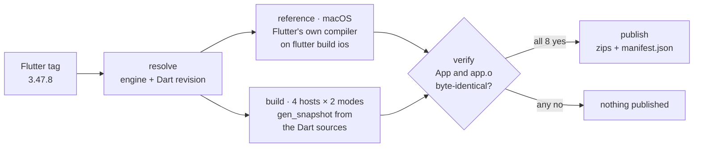

<div align="center">

# xcross-compilers

### Flutter's iOS compiler for Windows and Linux, for every Flutter release

[](https://github.com/Abdelrahman1atef/xcross-compilers/releases)


[](LICENSE)
[](https://sociabuzz.com/man_atef/tribe)

[**Releases**](https://github.com/Abdelrahman1atef/xcross-compilers/releases) · [**Use it**](#use-it) · [**How it is verified**](#how-a-release-is-made) · [**Dart SDK changes**](#what-changes-in-the-dart-sdk) · [**Support**](#support)

</div>

<br>

Flutter publishes its iOS AOT compiler (`gen_snapshot`) **for macOS only**, so release and profile iOS builds normally need a Mac. This repository builds the same compiler from the Dart sources each Flutter release pins, for **Windows and Linux**, and publishes it only after it wrote **byte-identical** output to Flutter's official compiler on a real `flutter build ios`.

[xcross](https://github.com/Abdelrahman1atef/xcross-studio) downloads these compilers by itself.

## What you get

Each Flutter stable release that passes verification gets a release here, named after its version (`3.47.8`). New Flutter versions are added within hours; older ones back to Flutter 3.0 are being filled in, newest first.

| Host | Release | Profile |
|---|:---:|:---:|
| `windows-x64` | ✅ | ✅ |
| `windows-arm64` | ✅ | ✅ |
| `linux-x64` | ✅ | ✅ |
| `linux-arm64` | ✅ | ✅ |

Each release holds `gen_snapshot-<release|profile>-<host>.zip` (the compiler at the root, plus `licenses/`) and a `manifest.json` with the Flutter version, the engine and Dart revisions, and the SHA-256 of every zip and executable.

## Use it

**With xcross**, there is nothing to do: `xcross flutter build --release` finds the compiler for your Flutter version, checks both SHA-256 digests and caches it. Check with:

```sh
xcross flutter sdk list
```

**By hand**: download the zip for your host, check it against `manifest.json`, and run `gen_snapshot` with the arguments `flutter_tools` passes for iOS.

## How a release is made



| Step | Where | What happens |
|---|---|---|
| **Resolve** | Linux | The Flutter tag gives the engine revision and the Dart revision (`DEPS` → `dart_revision`) |
| **Reference** | macOS | Installs that Flutter, runs `flutter build ios` on a new app, records the `app.dill`, the exact `gen_snapshot` command, and the SHA-256 of what Flutter's compiler writes |
| **Build** | each host | Fetches the Dart SDK at that revision with the Dart team's own tools, applies [the changes below](#what-changes-in-the-dart-sdk), and builds `gen_snapshot` with the settings Flutter uses for iOS |
| **Verify** | each host | The new compiler compiles the same `app.dill` with the same command; `App` and `app.o` must equal Flutter's byte for byte |
| **Publish** | Linux | Only when all eight compilers passed |

All of it runs in [GitHub Actions](.github/workflows/build.yml). A [watcher](.github/workflows/watch.yml) checks every two hours and builds each Flutter release that has no compiler yet, newest first, so a new Flutter version is covered within hours.

<details>
<summary><b>Build one yourself</b></summary>

<br>

Start a build in GitHub Actions:

```sh
gh workflow run build.yml -f flutter=3.47.8
```

Or build one on a Linux machine or WSL, the way CI does:

```sh
tool/local_build.sh 3.47.8 release
```

</details>

## What changes in the Dart SDK

All in [`tool/ios_target.py`](tool/ios_target.py). Each change makes a compiler built on Windows or Linux behave exactly like Flutter's on a Mac:

| Change | Why |
|---|---|
| **iOS as the target** (`xcross_ios_compiler`) | Dart only targets iOS when the build itself does, which needs a Mac. This gives a Windows or Linux build the same iOS defines, so it writes iOS arm64 code |
| **Timeline kept** | Dart removes the timeline from Linux release builds; Flutter's iOS VM keeps it |
| **Version text says `macos_arm64`** | Dart writes its version text, which names the build machine, into every `App` and `app.o` |
| **macOS's sort** ([`xcross_apple_sort.h`](tool/xcross_apple_sort.h)) | Dart sorts lists with ties, and every C library orders ties its own way. This is Apple's `qsort`, checked against the original on 12,240 inputs |
| **IDs taken in a fixed order** | C++ leaves the order of some expressions open, and Windows evaluates them right to left; two spots numbered `await` points differently |
| **`Basename` on Windows** | It returned nothing on Windows, so `app.o` was named after the app's main library instead of `App` |

Build settings follow Flutter's engine for iOS: `dart_target_arch = "arm64"`, no compressed pointers, release or profile runtime mode, and the SDK hash set to the first ten characters of the Dart revision.

## Support

Every Flutter release takes a macOS reference build and eight compiler builds before anything is published, and the watcher keeps that going for each new version. If these compilers save you a Mac:

<a href="https://sociabuzz.com/man_atef/tribe"></a>

Bug reports and pull requests help just as much.

## Licence

The tools here: [BSD 3-Clause](LICENSE). The compilers are builds of the [Dart SDK](https://github.com/dart-lang/sdk); each zip carries the Dart SDK licence, the licences of the third-party code built into it, and the BSD notice of the sort code.
